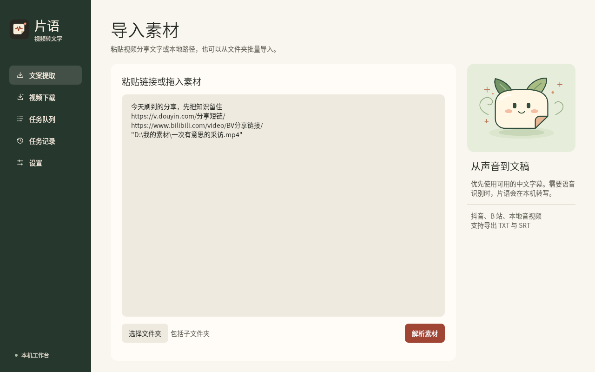
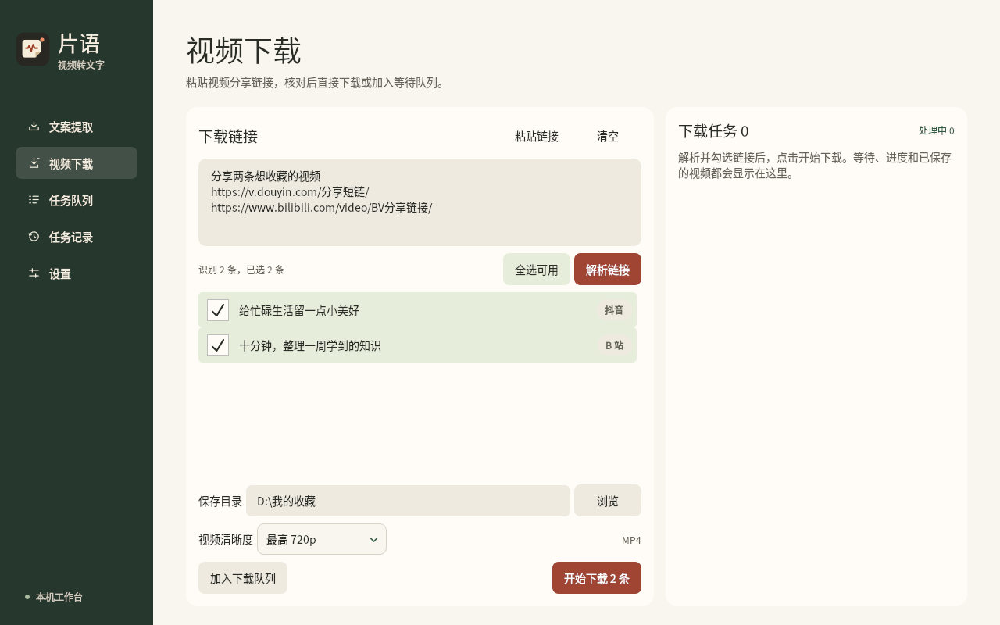

<div align="center">


# 片语 · Pianyu

**Windows 11 视频转文字与批量下载工具**

批量粘贴抖音、B 站链接，或导入本地音视频，提取讲话内容，导出简体中文 TXT 文稿和 SRT 字幕。<br />
语音识别在本机运行，无需付费语音 API；另有独立页面，支持批量下载抖音、B 站视频。

[](https://github.com/xuange1016/video_to_text/releases/latest)

[](LICENSE)
[](https://github.com/xuange1016/video_to_text/stargazers)

[⬇️ 下载片语](https://github.com/xuange1016/video_to_text/releases/latest) · [三步出稿](#三步把视频变成文稿) · [版本小脚印](CHANGELOG.md) · [反馈一只 bug](https://github.com/xuange1016/video_to_text/issues)

A Windows desktop app for batch video transcription and downloads. Local speech recognition, simplified Chinese output, TXT & SRT export.

</div>

## 先看看它长什么样



暖纸色、深绿侧栏，还有一只陪你等结果的小纸精灵。上图为应用实际界面，素材与任务数据为演示。

<details>
<summary>再看一眼独立的视频下载页 👀</summary>



粘贴链接、核对勾选、直接下载。文案和视频各有自己的入口，切来切去也保留本次输入。

</details>

## 它会干哪些活

| 你想做的事 | 片语来干 |
| --- | --- |
| 一堆链接懒得挨个点 | 单条、批量、整段分享文字都能粘贴，自动识别抖音 / B 站 |
| 文件散落在电脑各处 | 粘贴本地文件路径、选择文件夹递归扫描，或直接拖进窗口；同批重复项合并 |
| 想省点听写时间 | 优先读取可用中文字幕，取不到再用本地 Whisper 模型转写 |
| 识别结果偶尔冒繁体字 | 字幕与转写统一经过简体转换，导出 TXT / SRT / 两个都要 |
| 先攒素材，晚点一起跑 | 等待队列支持查看、改简称、改配置、批量编辑与移除，启动由你决定 |
| 想知道还要等多久 | 显示任务阶段、可测量的百分比及可估算时的剩余时间 |
| 刚才那条失败了 | 单条失败继续后面的任务，历史里能重试；保存失败可换目录补存 |
| 想收藏视频本体 | 独立「视频下载」页，支持最高 720p、最高 1080p、最佳可用画质，保存 MP4 |
| 界面也想有点小脾气 | 自绘图标、纸精灵、悬停与点击反馈；设置里可以减少动态效果 |

语音识别在本机执行，使用 CPU `int8`，不需要填写付费语音 API Key。网络素材获取和首次模型下载仍需要联网；模型缓存后，本地音视频可以离线转写。

## 先把小助手领回家

1. 打开 [Releases 下载页](https://github.com/xuange1016/video_to_text/releases/latest)。
2. 下载 `Pianyu-版本号-win-x64-Setup.exe`，双击安装。
3. 从开始菜单打开「片语」，选好保存目录，开工！

目前提供 **Windows 11 x64** 安装版。安装包约 **490 MB**，自带 Python、Qt、FFmpeg、yt-dlp 和专用 Chromium；模型另外按需下载。请预留数 GB 空间，给小助手的行李箱腾个位置。

安装包目前未做代码签名，Windows 可能提示未知发布者。请核对下载来源与该版本附带的 `SHA256SUMS.txt`，确认后再安装。

## 三步把视频变成文稿

**① 喂素材。** 打开「文案提取」，把链接、分享文字和本地路径放进输入框，或者选择文件夹 / 拖入文件，点击「解析素材」。

```text
这是一整段抖音分享文字 https://v.douyin.com/你的短链/
https://www.bilibili.com/video/你的BV号/
"D:\我的素材\采访 01.mp4"
D:\另一个文件夹\课堂录音.m4a
```

**② 点名上场。** 核对标题与来源，勾选要处理的素材，选择模型、导出格式和目录，再加入队列。默认不会替你勾选；「全选可用素材」能省几下鼠标。

**③ 等它交作业。** 到「任务队列」启动单条或全部等待任务。完成后查看纯文案 / 时间轴、复制文字或打开保存目录。处理中仍可添加下一批素材。

每条素材住一个独立文件夹，通常是这样：

```text
片语导出/
├─ 一次很有意思的采访/
│  ├─ 文案.txt
│  └─ 字幕.srt
└─ 今天学会的小知识/
   ├─ 文案.txt
   └─ 字幕.srt
```

只选 TXT 或 SRT 就只生成对应文件。同名素材会加入稳定的来源标识；主动重转另存版本。队列的简称只影响显示，导出仍使用原始标题。

## 想下载视频？走这边 🛒

侧栏打开 **「视频下载」** → 粘贴抖音 / B 站链接 →「解析链接」→ 勾选 → 选择画质和目录 →「开始下载」或「加入下载队列」。

这个页面有自己的输入区、勾选和下载任务列表，可以直接看进度、取消、重试、播放视频、打开目录。下载页点击「开始下载」只启动这次新建的下载批次，已在等待的文案任务继续等你点名。

成品保存在 `指定目录/视频标题/视频.mp4`。720p / 1080p 按画面**较短边**限制，竖屏也适用；平台只给较低画质时，就下载可获取的版本。画质选择不会把低清素材变高清，也不承诺会员、私密或受限资源可下载。

## small 还是 medium？给脑袋挑个饭量

| 模型 | 更适合 | 首次下载 | 怎么选 |
| --- | --- | --- | --- |
| **快速 · small** | 清晰口播、先批量跑初稿 | 约 480 MB | 先试它，看看你的素材效果如何 |
| **均衡 · medium** | 希望更好处理复杂中文口播 | 约 1.5 GB | 默认模型，通常更吃 CPU、内存与时间 |

在「设置」里可以**提前下载 small**，有进度、停止和重试。正式转写前不用掐着网速干着急。medium 在首次需要时下载；可用的平台字幕出稿无需加载语音模型。

转写质量仍取决于收音、口音、背景音乐和专有名词。重要稿件记得校对一下，纸精灵也有听岔的时候。

## 几个顺手的小机关

- **路径会回应你。** 设置里能校验目录是否可写；保存设置时会创建不存在的目录。按住 `Ctrl` 单击路径，或在路径框按 `Ctrl + Enter`，可以打开目录。
- **任务标题太长？** 默认显示前 24 个字符；等待项可以改个自己认得的简称，详情里仍看得到完整标题。
- **电脑还有余力？** 设置里把同时处理数从默认的 1 调到 2 或 3。CPU 转写占资源，条数增加不一定等比例变快，先从 1 开始最稳。
- **想换个出稿方式？** 平台字幕结果可点「用语音重转」。
- **保存翻车了？** 「待保存」说明结果还在，可换目录补存。视频已有完整缓存时也会优先补存；缓存丢失会提示重新下载，再点重试即可。
- **重启后接着来。** 等待队列、任务记录和结果保存在本机；上次运行中的任务标为「已中断」，在历史中重试即可。链接草稿只在当前运行期间保留。
- **不想看小精灵蹦跶？** 设置里打开「减少动态效果」。它会乖一点。

## 先说清楚，省得你和小精灵吵架

**支持范围：** 当前主打中文识别、简体输出，以及抖音、B 站公开可访问视频和本地音视频。B 站弹幕不当作字幕。英语、多语言、说话人区分、文稿编辑器、音频试听和移动端尚未作为本版功能交付。

**网络平台会变：** 删除、过期、登录限制、地区限制、风控和接口变化都可能让解析或获取失败。解析成功只表示识别了素材，不保证内容一定可取；请看该条错误提示，必要时换成可读取的本地文件。

**进度不会装懂：** 下载、转写等有数据的阶段显示百分比；获取信息、加载模型等阶段显示文字。预计时间随网速和电脑负载变化。

**数据在本机：** 任务、文稿、模型、缓存和日志写入当前 Windows 用户的应用数据目录；导出放在你指定的位置。获取网络视频、字幕与模型会连接对应平台及模型托管服务。请只处理你有权使用的素材。

## 想自己养一只、改一改代码？

主要技术栈：**Python 3.11 · PySide6 / QML · faster-whisper · OpenCC · SQLite · yt-dlp · FFmpeg · Playwright**。

```powershell
git clone https://github.com/xuange1016/video_to_text.git
cd video_to_text
py -3.11 -m venv .venv
.\.venv\Scripts\python.exe -m pip install -r requirements-dev.txt
.\.venv\Scripts\python.exe main.py
```

运行界面之外，完整媒体处理还需要 FFmpeg / ffprobe；抖音取流需要专用 Chromium。工具准备、测试和安装包构建见 **[开发与构建说明](docs/DEVELOPMENT.md)**。普通用户下载 Releases 安装包即可。

## 小脚印与小愿望

从最初能出稿，到等待队列、纸精灵、视频下载，再到独立下载工作台，变化都记在 [CHANGELOG](CHANGELOG.md)。本仓库于 2026-11-06 集中整理历史版本，来源与恢复情况见 [版本历史说明](docs/HISTORY.md)。

有 bug、有建议、遇到某条公开视频拿不到，都可以到 [Issues](https://github.com/xuange1016/video_to_text/issues) 留言。描述操作步骤、版本号和错误提示会更好排查；日志里有私人路径时记得先打个码。

如果片语替你省下了几次暂停、倒回、手抄的时间，欢迎点一颗 ⭐。小精灵没有 KPI，但会偷偷开心。

## 感谢路过的前辈们

语音转写配置与文稿分段参考了 [mumuxiaya/video2text](https://github.com/mumuxiaya/video2text)。也感谢 faster-whisper、CTranslate2、OpenCC、Qt for Python、Playwright、yt-dlp、FFmpeg 与 Noto 字体等项目。相关许可和声明见 [THIRD_PARTY.md](THIRD_PARTY.md) 以及发行包内附带文件。

本项目源码采用 [MIT License](LICENSE)。发行包中的第三方组件保留各自许可证。
